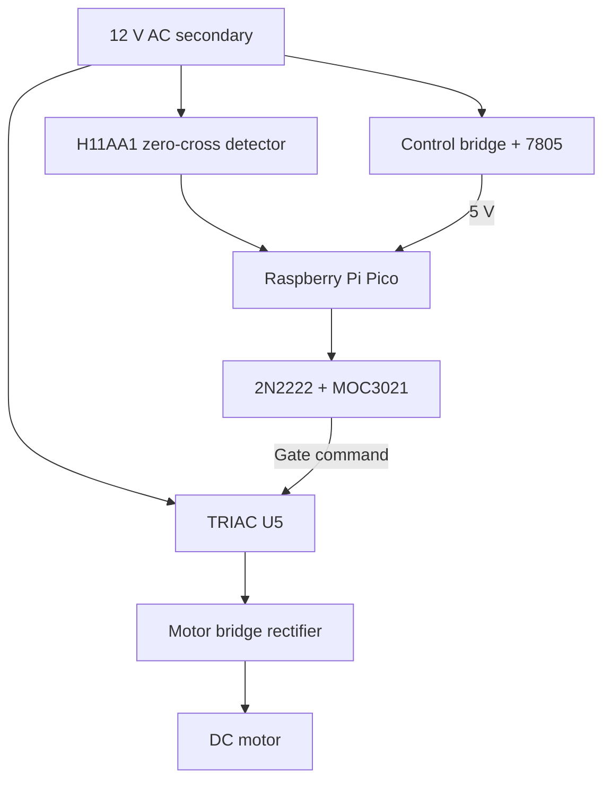
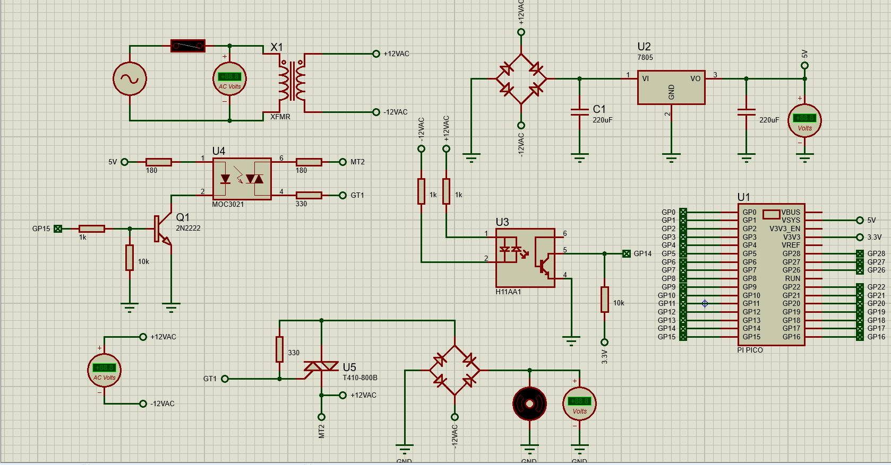
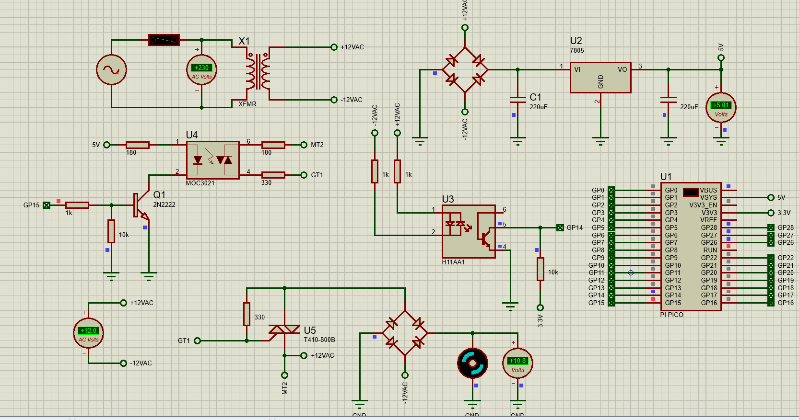
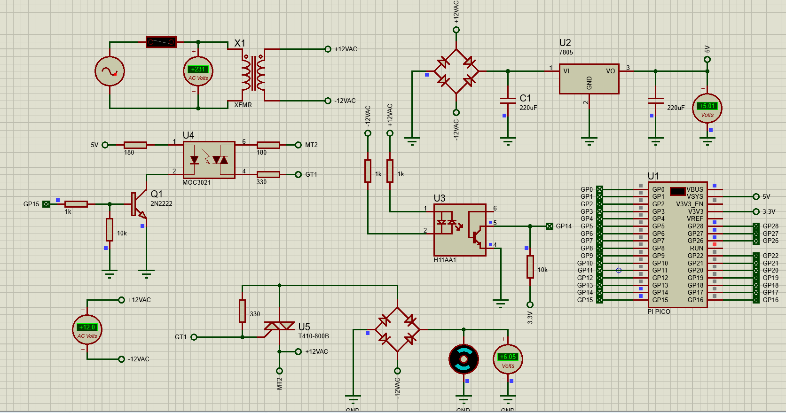

# Raspberry Pi Pico AC Phase-Angle Motor Controller

**Proteus 8 simulation prototype | MicroPython | H11AA1 + MOC3021 + T410-800B**

This is a **low-voltage development and simulation project** exploring synchronized phase-angle control of a **DC motor**. The Raspberry Pi Pico detects the AC zero crossings and generates delayed gate commands for a TRIAC. The TRIAC controls the AC supplied to a **second bridge rectifier**, which feeds the DC motor. A separate bridge rectifier and 7805 regulator supply the Pico control circuit.

**Project status:** Schematic and firmware developed; Proteus simulation ran and showed motor-voltage readings. **Motor-speed characteristics, gate timing, EMI performance, extended stability, and hardware safety have not been fully validated.** Laptop performance limited extended simulation.

## Short block diagram



The diagram illustrates the test-circuit architecture. It is not a certified electrical installation diagram or a guarantee of isolation between motor and control circuits.

## Components

- Raspberry Pi Pico (RP2040), programmed in MicroPython
- H11AA1 AC-input optocoupler for zero-cross detection
- 2N2222 transistor and MOC3021 random-phase optotriac driver
- T410-800B power TRIAC
- Two bridge rectifiers, 7805 voltage regulator, transformer, capacitors and resistors
- Simulated DC motor and voltage instruments

## Firmware and GPIO

| Signal | Pico GPIO | Purpose |
|---|---|---|
| H11AA1 output | GP14 | Zero-cross event input |
| MOC3021 input driver | GP15 | Delayed TRIAC-gate command |

`Firmware/main.py` contains the project's **V3 experimental phase-angle firmware**, with a 50 Hz synchronization target, an automatic **20-second** firing-angle cycle (**35°–95°**), and a fixed-angle diagnostic option. This is **phase-angle triggering, not high-frequency PWM**.

## Simulation screenshots

The screenshots are examples of the assembled Proteus circuit and voltage-display states, **not evidence of complete verification**.







## Repository contents

```text
Raspberry-Pi-Pico-AC-Phase-Angle-Motor-Controller/
├── README.md
├── LICENSE
├── .gitignore
├── Documentation/
│   ├── PROJECT_NOTES.md
│   └── GITHUB_SETUP.md
├── Firmware/
│   ├── main.py
│   └── main.txt
├── Proteus/
│   └── Raspberry Pi Pico AC Phase-Angle Motor Controller.pdsprj
└── Images/
    ├── simulation_view_1.png
    ├── simulation_view_2.png
    └── simulation_view_3.png
```

## How to open

1. Open the `.pdsprj` project from `Proteus/` in **Proteus 8 Professional**, with suitable Pico and device models installed.
2. Inspect the complete schematic and confirm power/ground connections and component model assignments before running it.
3. Review `Firmware/main.py`, particularly `FIRE_ENABLED` and `FIXED_ANGLE_DEG`.
4. Start simulation and record the GP14 zero-cross signal, GP15 firing command, motor voltage and motor speed where supported.

**Do not assume this design is ready for physical mains operation.** The supplied design is an experimental simulation. Its power stage, isolation, protection and component ratings need independent engineering assessment before any physical testing.

## Testing limitations and future work

- Full automatic RPM increase/decrease and speed regulation **not conclusively verified**
- Phase-angle timing accuracy and motor-load response **not comprehensively measured**
- EMI reduction, switching harmonics and snubber performance **not tested**
- Long-duration thermal and stability testing **not performed**
- No fabricated or physically tested controller is included
- Extended Proteus testing was limited by available laptop performance

The original ACS307B assignment requires a 230 V AC-fed, 375 W laboratory demonstration and restricts development boards. **This Pico-based simulation is not evidence of compliance with those final assessment requirements.**

## Author

**L.N. Sehlabane** — Electrical Engineering / Embedded Systems

## License

MIT License for the original files supplied here. Third-party tools, component models and simulation software remain subject to their own licenses.
